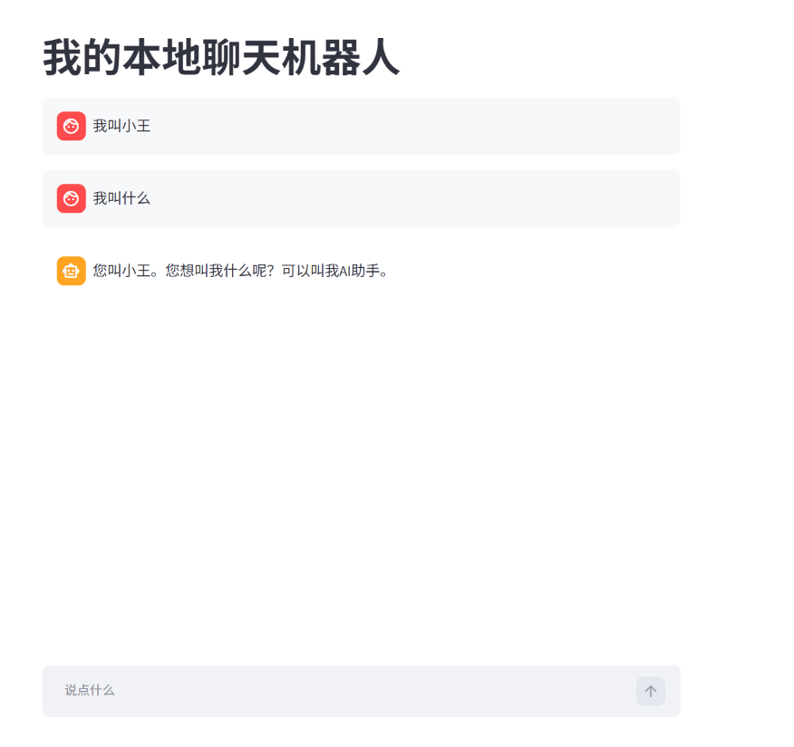

# K_ai_D 聊天机器人（Streamlit + Ollama）

一个跑在自己电脑上的聊天机器人：**模型本地运行，对话数据不出本机，不花钱，断网也能用。**

这是我学习「大模型开发」路线的第 1 个作品，用来打通「调用模型 → 管理对话历史 → 渲染界面」这条链路。

## 界面



## 功能

- **多轮对话**：历史存在 `st.session_state`，模型每轮收到完整上下文
- **开场问候**：固定开场白，并作为 `assistant` 消息进入历史 —— 模型知道“自己说过这句话”
- **一键清空**：侧边栏按钮重置对话，问候语会重新出现
- **失败兜底**：模型没启动 / 模型名写错时给出友好提示，并撤回刚发出的那条消息，不留“半条对话”
- **可换后端**：走 OpenAI 兼容接口（`/v1/chat/completions`），换成云端模型只需改 `base_url`

## 技术栈

| 组件 | 说明 |
|---|---|
| Python 3.14 | |
| Streamlit 1.66 | Web 界面 |
| Ollama | 本地模型运行时 |
| openai SDK | 通过 OpenAI 兼容接口调用本地模型 |

## 运行

前提：本机已安装并启动 [Ollama](https://ollama.com)，且已拉取模型。

```powershell
python -m venv .venv
.\.venv\Scripts\Activate.ps1
pip install -r requirements.txt

ollama pull qwen2.5:7b

streamlit run app.py
```

浏览器打开 http://localhost:8501 。

> 必须用 `streamlit run app.py` 启动，直接 `python app.py` 页面会是空白的。
>
> 不想激活虚拟环境时，可以直接用完整路径启动：`.\.venv\Scripts\streamlit.exe run app.py`

## 文件说明

| 文件 | 作用 |
|---|---|
| `app.py` | 主程序：界面 + 对话历史 + 模型调用 |
| `demo.py` | 命令行最小示例，演示 `messages` 结构和多轮上下文 |
| `requirements.txt` | 依赖版本 |
| `docs/screenshot.png` | 界面截图 |

## 几个踩过的坑（写给自己看）

1. **`st.session_state` 只活在当前会话里**：脚本重跑（输入、点按钮）时保留，浏览器 F5 刷新就清空。想持久化得写文件或数据库。
2. **Streamlit 是自上而下执行一次**：新消息 `append` 之后必须当场画一遍气泡，否则要等下一次交互才显示，永远“慢一拍”。
3. **模型的回答也要存进历史**：只存用户的话，模型就不记得自己说过什么，聊两轮开始重复。
4. **`st.button()` 返回布尔值**：必须 `if st.button(...)`，不能像 `if`/`for` 那样直接跟冒号。
5. **初始消息要用函数返回，不要用模块级常量**：首次进入页面和点“清空对话”两处都要拿一份初始对话。若写成 `messages = INITIAL_MESSAGES`，两处拿到的是**同一个列表对象**，后面 `append` 会把这份模板也改掉。用函数 `return [...]`，每次调用都新建一份，才不会互相污染。
6. **开场问候要进历史才算数**：直接 `st.chat_message(...).write(...)` 画在界面上，模型并不知道自己说过 —— 它只认 `messages` 里的内容。

## 后续可以做的

- [ ] 流式输出（打字机效果，`stream=True`）
- [ ] 只保留最近 N 轮历史，避免超出上下文长度
- [ ] 多会话管理 + 落盘保存
- [ ] 换个界面主题 / 加头像
- [ ] 用 system prompt 固定“人设”，让模型自称 K_ai_D（现在它会说自己是阿里云的产品）